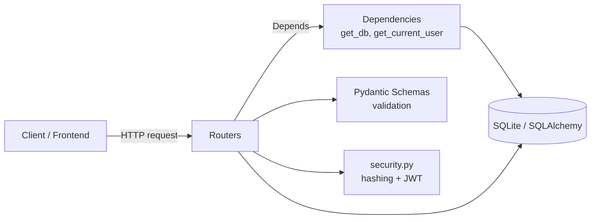
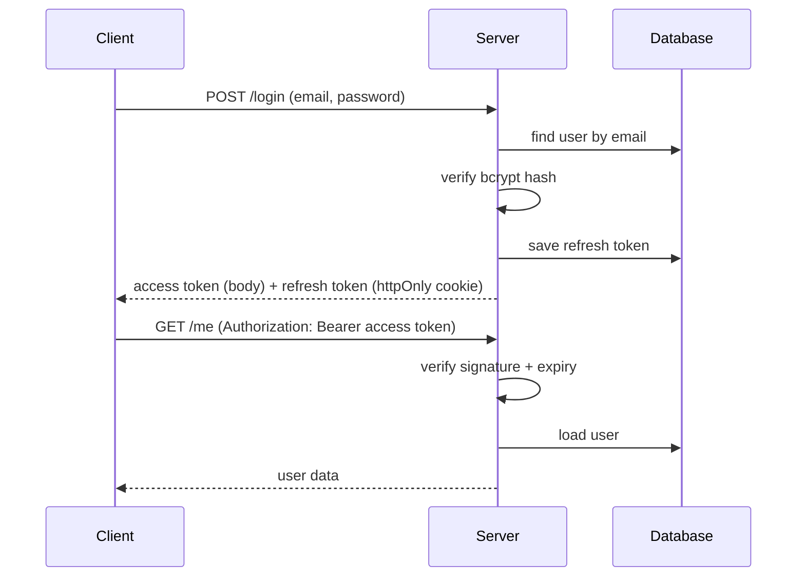
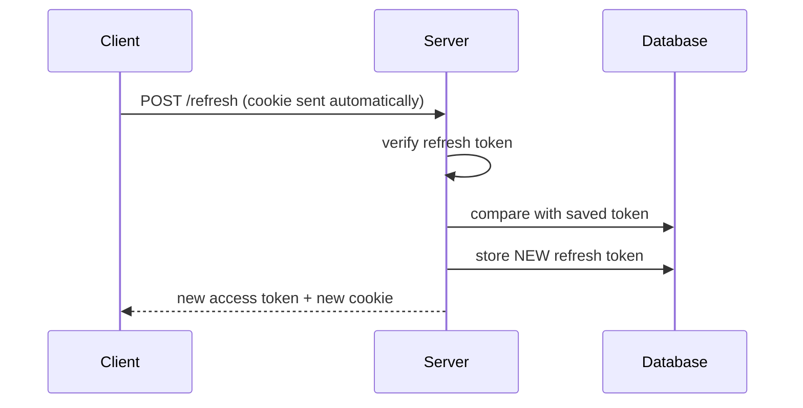

# Auth Service (FastAPI)

A secure authentication and authorization backend built with **Python and FastAPI**. It covers the full lifecycle of a user account: registration, login, short-lived access tokens, rotating refresh tokens, protected routes, role-based access control, and account recovery.


A production-style authentication and authorization API built with FastAPI, PostgreSQL and Docker, deployed on Render.

**Live demo:** https://vivi-auth-service.onrender.com/docs

---

## Table of Contents

1. [What this project is](#what-this-project-is)
2. [Tech stack](#tech-stack)
3. [Key concepts](#key-concepts)
4. [Architecture](#architecture)
5. [Authentication flows](#authentication-flows)
6. [Security design decisions](#security-design-decisions)
7. [API reference](#api-reference)
8. [Project structure](#project-structure)
9. [Getting started](#getting-started)
10. [Configuration](#configuration)
11. [Testing the API](#testing-the-api)
12. [Roadmap](#roadmap)
13. [What I learned](#what-i-learned)

---

## What this project is

Almost every real application needs to answer two questions:

- **Authentication:** *who are you?*
- **Authorization:** *what are you allowed to do?*

This service answers both. It is a standalone REST API that a web or mobile frontend can call to sign users up, log them in, and protect other endpoints. It is built the way production systems are built: passwords are never stored in plain text, tokens expire, sessions can be revoked, and errors never leak sensitive details.

---

## Tech stack

| Layer | Tool | Why it is used |
|---|---|---|
| Language | Python 3 | Core language |
| Web framework | **FastAPI** | Fast, modern, automatic validation and API docs |
| Server | **Uvicorn** | ASGI server with auto-reload for development |
| Database toolkit | **SQLAlchemy** | Maps Python classes to database tables (ORM) |
| Database | **PostgreSQL** | Zero-setup file database (SQLite for tests) |
| Validation | **Pydantic** | Validates request and response data automatically |
| Tokens | **PyJWT** | Creates and verifies JSON Web Tokens |
| Password hashing | **bcrypt** | Slow, salted, one-way password hashing |
| Config | **python-dotenv** | Loads secrets from a `.env` file |
| Containerization | **Docker** |
| Deployment | **Render** |
---

## Key concepts

### Password hashing
Passwords are never stored. Only a **bcrypt hash** is saved. A hash is one-way: it cannot be turned back into the password. At login, the typed password is hashed and compared with the stored hash. Each hash includes a random **salt**, so two users with the same password get different hashes.

### JWT (JSON Web Token)
A signed token the server hands out after login. It contains the user's `id` (`sub`), `role`, and an expiry time (`exp`). The server verifies the signature on every request, so it does not need to look the token up in a database.

### Access token vs refresh token

| | Access token | Refresh token |
|---|---|---|
| Lifetime | 15 minutes | 7 days |
| Purpose | Authorize every API request | Get a new access token |
| Sent via | `Authorization: Bearer <token>` header | `httpOnly` cookie |
| Signed with | `JWT_ACCESS_SECRET` | `JWT_REFRESH_SECRET` |

Two tokens limit the damage of theft: a stolen access token dies in 15 minutes.

### httpOnly cookie
The refresh token is stored in a cookie that browser JavaScript cannot read. This protects it from cross-site scripting (XSS) attacks.

### Token rotation
Every time a refresh token is used, a **new** one is issued and the old one stops working. A stolen, already-used refresh token is useless.

### Dependency injection (`Depends`)
FastAPI's way of sharing reusable logic, such as "give me a database session" or "give me the logged-in user". It is the Python equivalent of middleware in other frameworks.

### RBAC (Role-Based Access Control)
Each user has a role (`user` or `admin`). Endpoints declare which roles may call them. A normal user calling an admin endpoint gets **403 Forbidden**.

---

## Architecture



**Layers, in plain words:**

- **Routers** receive requests and decide what to do.
- **Schemas** check that incoming data has the right shape, and filter outgoing data so secrets never leak.
- **Dependencies** are reusable checkpoints (database session, current user).
- **Security** holds the password and token logic in one place.
- **Models** define the database tables.

---

## Authentication flows

### Login and protected request



### Token refresh (with rotation)



### Logout
The saved refresh token is deleted from the database and the cookie is cleared. Even if someone copied the cookie earlier, it no longer matches the database and is rejected.

---

## Security design decisions

| Decision | Reason |
|---|---|
| Store only the bcrypt hash | A database leak does not expose real passwords |
| Same error for wrong email and wrong password | Stops attackers from discovering which emails are registered |
| `role` is never read from the register request | Nobody can sign up as an admin |
| Response schemas exclude the password hash | Secrets cannot leak by accident |
| Separate secrets for access and refresh tokens | Compromising one does not compromise the other |
| Short-lived access tokens | Limits the window of a stolen token |
| Refresh token in an `httpOnly` cookie | JavaScript (and XSS) cannot read it |
| Refresh token saved in the database | Enables real logout and revocation |
| Token rotation | Old refresh tokens become useless |
| Secrets in `.env`, excluded from Git | Keys never reach the repository |
| Correct status codes (401/403/409/422) | Clients can react properly to each failure |

---

## API reference

Base URL (local): `http://127.0.0.1:8000`
Interactive docs: `http://127.0.0.1:8000/docs`

### Implemented

| Method | Endpoint | Description | Auth required |
|---|---|---|---|
| POST | `/api/auth/register` | Create an account |
| POST | `/api/auth/login` | Returns access token and sets refresh cookie |
| GET | `/api/auth/me` | Returns the current user | Access token |
| POST | `/api/auth/refresh` | Issues a new access token and rotates the refresh token | Refresh cookie |
| POST | `/api/auth/logout` | Revokes the refresh token | Access token |
| GET | `/health` | Health check | 
| GET | `/api/admin/users` | List all users | Admin role |
| PATCH | `/api/admin/users/{id}/role` | Change a user's role | Admin role |
| POST | `api/admin/users/{id}/unlock` | Admin role |
| POST | `/api/auth/forgot-password` | Email a password reset link |
| POST | `/api/auth/reset-password` | Set a new password using the reset token | Reset token |
| GET | `/api/auth/google/login` | Start Google sign-in |
| GET | `/api/auth/google/callback` | Finish Google sign-in |

### Status codes used

| Code | Meaning in this API |
|---|---|
| 200 | Success |
| 201 | Account created |
| 401 | Not authenticated (bad, missing, or expired token; wrong credentials) |
| 403 | Authenticated but not allowed (wrong role) |
| 409 | Email already registered |
| 422 | Request body failed validation |
| 429 | Too many requests (rate limiting) |
| 423 | Locked: account temporarily locked |

---

## Project structure

```
auth-service/
├── app/
│   ├── __init__.py
│   ├── main.py            # App entry: creates tables, registers 
│   ├── limiter.py
│   ├── middleware.py
│   ├── logger.py          # logs
routers
│   ├── database.py        # Engine, session factory, get_db dependency
│   ├── models.py          # SQLAlchemy User table
│   ├── schemas.py         # Pydantic request/response shapes
│   ├── security.py        # bcrypt hashing + JWT create/decode
│   ├── dependencies.py    # get_current_user (protected-route checkpoint)
│   └── routers/
│       ├── __init__.py    # register, login, me, refresh, logout
│       ├── admin.py
│       ├── auth.py
│       └── google.py                            
├── .env 
├── Dockerfile
├── docker-compose.yml
├── .dockerignore
├── requirements-dev.txt                 
├── .gitignore
├── create_admin.py 
├── requirements.txt
└── README.md
```

---

## Getting started

### Prerequisites
- Python 3.10 or higher
- Git

### Installation

```bash
# 1. Clone
git clone https://github.com/vvingg022/auth-service-fastapi.git
cd auth-service-fastapi

# 2. Create and activate a virtual environment
python -m venv venv
venv\Scripts\activate          # Windows
# source venv/bin/activate     # macOS / Linux

# 3. Install dependencies
pip install -r requirements.txt

# 4. Create your .env file from the template
copy .env.example .env          # Windows
# cp .env.example .env          # macOS / Linux

# 5. Run the server
uvicorn app.main:app --reload
```

Open **http://127.0.0.1:8000/docs** to explore and test the API.

> Always start the app with `uvicorn`. Running `main.py` directly (for example with an editor's Run button) fails because the app uses package-relative imports.

## Running with Docker (PostgreSQL)

```bash
# 1. Create .env from the template and fill in the values
copy .env.example .env

# 2. Build and start the API + PostgreSQL
docker compose up --build

# 3. Create the first admin
docker compose exec api python create_admin.py
```

API: http://127.0.0.1:8000 · Docs: http://127.0.0.1:8000/docs

| Command | Effect |
|---|---|
| `docker compose down` | Stop (data is kept) |
| `docker compose down -v` | Stop and delete the database |

The database is not exposed outside Docker, and secrets are injected from `.env` at runtime, not baked into the image.

---

## Configuration

Create a `.env` file in the project root:

```env
DATABASE_URL=sqlite:///./auth.db
JWT_ACCESS_SECRET=<random string 1>
JWT_REFRESH_SECRET=<random string 2>
ACCESS_EXPIRE_MINUTES=15
REFRESH_EXPIRE_DAYS=7
```

## CORS ---
CORS_ORIGINS=http://localhost:3000,http://127.0.0.1:3000


## Password reset and email ---
FRONTEND_URL=http://localhost:3000
RESET_TOKEN_MINUTES=30
SMTP_HOST=
SMTP_PORT=2525
SMTP_USER=
SMTP_PASSWORD=
EMAIL_FROM=no-reply@authservice.local


## Google login ---
GOOGLE_CLIENT_ID=<from Google Cloud Console>
GOOGLE_CLIENT_SECRET=<from Google Cloud Console>
GOOGLE_REDIRECT_URI=http://127.0.0.1:8000/api/auth/google/callback
SESSION_SECRET=<random string 3>
```

Generate each secret with:

```bash
python -c "import secrets; print(secrets.token_hex(32))"
```
Use a **different** value for each secret.

| Variable | Meaning |
|---|---|
| `DATABASE_URL` | Database connection string |
| `JWT_ACCESS_SECRET` | Signing key for access tokens |
| `JWT_REFRESH_SECRET` | Signing key for refresh tokens (must differ from the access secret) |
| `ACCESS_EXPIRE_MINUTES` | Access token lifetime |
| `REFRESH_EXPIRE_DAYS` | Refresh token lifetime |
| `CORS_ORIGINS` | Comma-separated list of websites allowed to call the API |
| `FRONTEND_URL` | Base URL used in password reset links |
| `RESET_TOKEN_MINUTES` | How long a reset token stays valid |
| `SMTP_*`, `EMAIL_FROM` | Email server settings. If `SMTP_HOST` is empty, reset emails print to the terminal (development only) |
| `GOOGLE_CLIENT_ID` / `GOOGLE_CLIENT_SECRET` | OAuth credentials from Google Cloud |
| `GOOGLE_REDIRECT_URI` | Must exactly match the URI registered in Google Cloud |
| `SESSION_SECRET` | Signs the short-lived cookie that protects the OAuth `state` |

> The server restarts automatically when `.py` files change, but **not** when `.env` changes. Restart `uvicorn` after editing `.env`.

---

## Testing the API

Use the built-in docs page at `/docs`.

| # | Action | Expected result |
|---|---|---|
| 1 | Register a new user | 201, no password in the response |
| 2 | Register the same email again | 409 |
| 3 | Register with a bad email and short password | 422 |
| 4 | Login with correct credentials | 200 with `access_token` |
| 5 | Login with a wrong password | 401 |
| 6 | Click **Authorize**, paste the token, call `/me` | 200 with user data |
| 7 | Call `/refresh` | 200 with a new access token |
| 8 | Call `/logout`, then `/refresh` again | 401 (token revoked) |
| 9 | Authorize with a fake token, call `/me` | 401 `Invalid token` |

**Verify hashing:** open the `users` table in the SQLite file and check that `password_hash` starts with `$2b$` and is not the real password.

Refresh and access tokens include a unique jti claim, so tokens issued in the same second are still distinct and rotation always invalidates the old token.**(Found by an automated test.)**

---

## Roadmap

### Phase 1: Foundation (complete)
- [x] Project setup with virtual environment and dependencies
- [x] SQLAlchemy `User` model with unique, indexed email
- [x] Pydantic validation for register and login
- [x] Register endpoint with bcrypt hashing
- [x] Login endpoint issuing access and refresh tokens
- [x] httpOnly refresh cookie

### Phase 2: Sessions (complete)
- [x] `get_current_user` dependency for protected routes
- [x] `/me` endpoint
- [x] Refresh endpoint with token rotation
- [x] Logout that revokes the refresh token
- [x] Handling of expired and invalid tokens

### Phase 3: Authorization (complete)
- [x] `require_role("admin")` dependency
- [x] Admin-only endpoints (list users, change roles)
- [x] 403 responses for insufficient permissions
- [x] Safe way to create the first admin

### Phase 4: Hardening (complete)
- [x] Rate limiting on login and register (brute-force protection)
- [x] Security headers and CORS configuration
- [x] Account lockout after repeated failed logins
- [x] Structured logging of security events

### Phase 5: Account recovery and social login
- [x] Forgot-password endpoint with a time-limited reset token
- [x] Reset email via SMTP (Mailtrap for testing)
- [x] Reset-password endpoint that also revokes existing sessions
- [x] "Login with Google" using OAuth 2.0

### Phase 6: Production readiness
- [x] Automated tests with `pytest`
- [x] Switch to PostgreSQL
- [x] Dockerfile and `docker-compose.yml`
- [x] Deployment (Render or Railway)

---

## What I learned

- The difference between **authentication** and **authorization**
- Why passwords are hashed, not encrypted, and why bcrypt is slow on purpose
- How JWTs work and why access and refresh tokens are separate
- Why refresh tokens go in `httpOnly` cookies and why they are rotated
- How FastAPI dependencies replace repeated checks with reusable checkpoints
- How to design error responses that help clients without helping attackers
- How to keep secrets out of version control
- Why tests catch bugs that manual clicking misses (see below)
- Free hosting trades convenience for limits, and you have to design around them


## Testing story

- Automated tests found a bug where two tokens created in the same second were identical, because
  the token timestamps had one-second resolution. 

---

